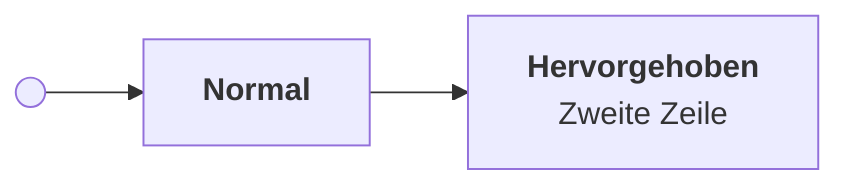

# mpe-notion-theme

Notion-Look für die **Markdown Preview Enhanced** Vorschau in VS Code, inklusive passend gestylter Mermaid-Diagramme. Die Konfiguration liegt in diesem Repo, damit sie auf allen Geräten identisch ist.

## Was drin ist

| Datei | Zweck |
| --- | --- |
| `style.less` | Das Theme: zentrierte Spalte (max. 900px), Notion-Typografie, Code, Tabellen, Zitate, Hell und Dunkel (folgt VS Code) und das Styling aller Mermaid-Diagramme |
| `parser.js` | Bausteine für das Preview, erzeugt aus `src/`, nicht von Hand ändern |
| `src/` | Kern zum Einlesen, Prüfen und Rendern sowie der Adapter für MPE |
| `config.js` | Crossnote-Config mit der Mermaid-Konfiguration: klassischer Look, Schrift, Abstände, gerade Linien |
| `skills/mermaid-theme` | Agent-Skill: Diagramme nutzen nur die Theme-Klassen und definieren keine Farben |
| `visual-markdown.js` | Kopierknöpfe im Preview, wird von `install.sh` ins MPE-Verzeichnis kopiert |
| `examples/bausteine.md` | Testseite mit allen Bausteinen, nach Änderungen im MPE-Preview öffnen |
| `install.sh` | Verlinkt `style.less`, `config.js` und `parser.js` in `~/.local/state/crossnote/` (Backup der alten Dateien als `.bak`), kopiert `visual-markdown.js` und trägt es in `head.html` ein |

## Einrichten auf einem neuen Gerät

```bash
git clone <repo-url> ~/Projects/mpe-notion-theme
~/Projects/mpe-notion-theme/install.sh
```

Danach in VS Code `Cmd+Shift+P` und `Developer: Reload Window`. Auf Windows liegt das Verzeichnis unter `%USERPROFILE%\.local\state\crossnote`, dort die Dateien manuell kopieren oder verlinken.

Weil `install.sh` Symlinks setzt, landen Änderungen über `Markdown Preview Enhanced: Customize CSS` direkt in diesem Repo. Dann nur noch committen und pushen.

## Änderungen testen

Die Preview überschreibt standardmäßig `margin` mit `0`. Eine gezielte Regel für den Preview-Container hält die Spalte trotzdem mittig. Der Hintergrund neben der Spalte folgt dem hellen oder dunklen Theme.

- Änderungen an `style.less`: Vorschau neu laden.
- Änderungen an `config.js` (Mermaid-Optionen): Window neu laden, sonst greifen sie nicht.
- Danach `examples/bausteine.md` im Preview öffnen. Die Seite zeigt jeden Baustein und sagt, worauf man achten soll.

## Bausteine

Das Stand-Band zeigt den Stand, das Erstellungsdatum und den optionalen Status aus `visual:` im Frontmatter, also `as-of`, `created` und `status`. Beide Daten stehen im Format `JJJJ-MM-TT`. Wer das Dokument ändert, setzt `as-of` neu. Ein Stand, der älter als sieben Tage ist, bekommt eine Warnfarbe. Rechts im Band kopiert ein Knopf den Pfad des Dokuments, damit man mit einem Agent über die ganze Datei sprechen kann. Ein `steps`-Block zeigt Fortschritt und eine nummerierte Arbeitsübersicht mit Zuständen und Zuständigen. Fehler im Block erscheinen mit der Zeilennummer. Das Datum steht unter `visual.as-of`. Die ergänzten Texte sind auf Deutsch, mit `visual.lang: en` auf Englisch.

Das Format steht unter [steps](#steps). Die Bausteine haben eigene Flächen und Statusfarben, angelehnt an [LioCare](https://www.figma.com/design/wc58qYYenP6PLzQ7yuARzW/LioCare?node-id=12-2). Sie sind vom Seitenhintergrund abgesetzt. Normale Tabellen erscheinen im selben Kartenstil wie die Schrittliste, mit runden Ecken und nur waagerechten Linien. Links im Text werden zu Badges mit Link-Icon. Chrome erhält ihre Farben auch beim PDF-Export ohne aktivierte Hintergrundgrafiken. Im PDF entfallen Kartenschatten und der zusätzliche Preview-Einzug. Der Seitenrand beträgt 14 mm. Der Zehn-Sekunden-Test und die abschließende Entscheidung zum Prototyp stehen noch aus.

```bash
npm install && npm test
./install.sh
```

Für den Kopierknopf braucht MPE in den VS-Code-Einstellungen `"markdown-preview-enhanced.enablePreviewScripts": true` und einen vertrauenswürdigen Workspace. `install.sh` kopiert dafür `visual-markdown.js` ins MPE-Verzeichnis und trägt es in `head.html` ein. Kopiert statt verlinkt, weil MPE Links auflöst und Skripte nur aus seinem eigenen Verzeichnis lädt. Nach Änderungen an `visual-markdown.js` deshalb `./install.sh` erneut ausführen. Ohne die Einstellung bleibt der Knopf verborgen, alles andere funktioniert gleich.

`npm test` baut `parser.js` aus `src/` und führt die Tests aus. Das Build-Ergebnis wird mitcommittet, damit die Installation ohne Node funktioniert. `install.sh` verlinkt auch `parser.js` und sichert vorhandene Dateien als `.bak`. Nach Änderungen am Parser in VS Code `Developer: Reload Window` ausführen.

## steps

Die Feldnamen sind Englisch. Ältere deutsche Feldnamen und `visual.stand` bleiben zum Lesen bestehender Dateien unterstützt. Ein `steps`-Block bleibt in der Datei eine lesbare Checkliste. Die Zustände sind `[x]` fertig, `[~]` läuft, `[!]` wartet und `[ ]` offen. Jeder Schritt hat ein festes Kürzel. Optionale Angaben folgen nach ` | `. Eingerückter Text unter der Zeile ist die Beschreibung des Schritts:

| Feld | Bedeutung |
| --- | --- |
| `after` | Kürzel der vorher nötigen Schritte, durch Kommas getrennt |
| `waiting-for` | Externe Rückmeldung oder Bedingung |
| `owner` | Zuständige Person, Team oder `Agent`, als Badge mit Personen- oder Agent-Icon |
| `done-when` | Abschlussbedingung, erscheint als „Ziel“, bei fertigen Schritten ausgeblendet |
| `since` | Zeitpunkt, seit dem der Zustand gilt, bei wartenden Schritten hinter dem Wartegrund |
| `next` | Konkrete nächste Handlung bei laufender oder startbereiter Arbeit |
| `updated` | Pflichtfeld: Datum der letzten Änderung am Schritt, Format `JJJJ-MM-TT` |
| `thread` | T3-Code-Thread, in dem ein Agent an dem Schritt arbeitet, als Erwähnung im Format `[Thread: Titel; ref=…]` |

```steps
- [x] prep: Daten vorbereiten | owner: Team | updated: 2026-11-01
- [~] run: Verarbeitung ausführen | next: Stichprobe prüfen | after: prep | done-when: alle Eingaben verarbeitet und Fehler geprüft | owner: Team | updated: 2026-11-01
  Wir ergänzen fehlende Angaben in den ausgelesenen Positionen. Erst danach lassen sich die Preise verschiedener Lieferanten vergleichen.
- [ ] review: Ergebnisse prüfen | after: run | updated: 2026-11-01
- [!] approve: Freigabe einholen | waiting-for: Rückmeldung | updated: 2026-11-01
- [ ] publish: Ergebnisse übernehmen | after: review, approve | updated: 2026-11-01
- [ ] docs: Dokumentation vorbereiten | updated: 2026-11-01
```

Der Titel sagt das Ergebnis des Schritts. Die Beschreibung sagt in ein bis drei Sätzen, was passiert und warum es wichtig ist, und der erste Satz muss allein verständlich sein, weil er in der Übersicht als Zeile steht. Interne Kürzel brauchen eine Erklärung. Mehrere eingerückte Zeilen werden zu einem Absatz zusammengefasst. Ausführliches gehört in einen Abschnitt mit derselben Kennung wie der Schritt, also `## Badges {#badges updated=…}` zum Schritt `badges`. Der Schritt verlinkt dann von selbst darauf.

Die Liste sieht aus wie eine Aufgabenliste in Linear. Sie ist nach Zustand gruppiert, in „Kann starten“, „Läuft“, „Geplant“, „Wartet“ und „Fertig“, jede Gruppe mit Icon und Anzahl. Leere Gruppen entfallen, innerhalb einer Gruppe bleibt die Dateireihenfolge. Jeder Schritt ist eine Zeile: Status-Icon, die feste Kennung klein über dem Titel, darunter die Beschreibung gekürzt auf eine Zeile. Bei wartenden Schritten steht dort zusätzlich der Wartegrund mit „seit“. Rechts stehen die offenen Dependencies mit ihrer Kennung, Zuständige als Person oder Agent, Thread, gegebenenfalls „seit“, das Datum der letzten Änderung, der Kopierknopf und ein Pfeil. Ein Klick auf die Zeile klappt die volle Beschreibung, „Als Nächstes“, „Ziel“ aus `done-when` und den Link zum Abschnitt auf. Im PDF ist alles aufgeklappt. Ein Klick auf den Kopierknopf kopiert nur und klappt nichts auf. „Kann starten“ enthält offene Schritte ohne ausstehende Vorgänger und ohne Wartegrund, „Geplant“ die Schritte, deren Vorgänger noch nicht fertig sind, „Wartet“ Schritte mit Wartegrund oder `[!]`. Die feste Kennung lässt sich zum Kopieren als Ganzes markieren.

Positionsnummern gibt es nicht, weil sie sich bei jedem Zustandswechsel verschieben würden. Wie in Linear ist die feste Kennung der Name eines Schritts. Dependencies zeigen deshalb die Kennung, verlinken auf den Schritt und haben seine Farbe, also gelb, wenn er wartet. Erfüllte Voraussetzungen verschwinden. Der Thread erscheint als Badge mit seinem Titel. Der Kopierknopf kopiert einen Verweis wie `/pfad/zur/datei.md#enrich` und hängt den Thread an, falls `thread` gesetzt ist. Den Verweis fügt man in den Chat mit einem Agent ein, damit klar ist, über welchen Schritt man spricht.

Der Agent pflegt Zustände, Wartegründe, Abschlussbedingungen und Daten in der Datei. Bei jeder Änderung an einem Schritt setzt er dessen `updated` und das `as-of` des Dokuments auf den aktuellen Tag. Der Renderer berechnet daraus die Übersicht, erkennt aber keinen Arbeitsfortschritt außerhalb der Datei. Unterpunkte werden noch nicht unterstützt. Unbekannte Felder, doppelte Kürzel, fehlende Vorgänger und Zyklen erscheinen als Fehler mit Zeilennummer.

## Badges

Eine Zeile `badges:` unter `visual:` im Frontmatter ordnet festen Wörtern eine Farbe zu:

```yaml
visual:
  badges: { fertig: ok, offen: warn, fehlt: bad, läuft: info, später: muted }
```

Jede Tabellenzelle, deren ganzer Text eines dieser Wörter ist, erscheint dann als getönte Pille mit Punkt, wie die Health-Werte in LioCare. Groß- und Kleinschreibung spielt keine Rolle. Die Farben sind `ok` grün, `warn` gelb, `bad` rot, `info` indigo und `muted` grau, andere Werte werden ignoriert. Kopfzeilen, Zellen mit weiterem Text und Tabellen in Codeblöcken bleiben, wie sie sind. In der Datei bleibt die Tabelle eine normale Markdown-Tabelle.

## Karten

Eine Karte ist ein Callout mit `[!card …]` in der ersten Zeile. Danach folgen Icon und Farbe in beliebiger Reihenfolge, dann der Titel. Darunter steht normales Markdown mit Listen, Links und Tabellen:

```markdown
> [!card flag green] E51: Pro Werk anfragen
> Entschieden am 30. Oktober. Wir fragen pro Werk an, weil die Preise je Standort verschieden sind.
```

Icons gibt es aus einer festen Liste: `flag`, `question`, `check`, `warning`, `bulb`, `info`, `pin`, `clock` und `note`. Die Farben sind `green`, `yellow`, `red`, `indigo` und `grey`, die Badge-Namen `ok`, `warn`, `bad`, `info` und `muted` gehen auch. Ohne Farbe ist die Karte grau, ohne Icon steht nur der Titel. Unbekannte Wörter werden ignoriert. Eine Karte ersetzt eigene Bausteine für Entscheidungen, Fragen oder Risiken. Auf GitHub erscheint sie als normales Zitat. Normale Zitate und die GitHub-Callouts wie `> [!NOTE]` bleiben, wie sie sind.

## Diagramme

Ein `chart`-Block steht direkt unter der Tabelle mit den Zahlen und sagt nur, welche Spalten wohin gehören. Leerzeilen dazwischen sind erlaubt, anderer Text nicht:

````markdown
| Lieferant | Spend in T€ |
| --- | ---: |
| Lieferant A | 1.240 |
| Lieferant B | 860 |

```chart
type: bar
x: Lieferant
y: Spend in T€
says: Lieferant A macht den größten Teil des Spends aus.
basis: Rechnungen 2025
```
````

| Feld | Bedeutung |
| --- | --- |
| `type` | Pflicht. `bar` für Balken, `line` für Linien, `histogram` für eine schon ausgezählte Verteilung |
| `x` | Pflicht. Spalte mit den Kategorien, Wochen oder Klassen. Die Reihenfolge kommt aus der Tabelle |
| `y` | Pflicht. Spalte mit den Zahlen. Mehrere Spalten mit Komma ergeben mehrere Reihen |
| `says` | Pflicht. Die Aussage in einem Satz, steht fett über dem Diagramm |
| `basis` | Pflicht. Worauf die Zahlen beruhen, steht klein darunter |
| `color` | Spalte, nach der Balken gestapelt oder Linien getrennt werden |
| `percent` | `yes` rechnet gestapelte Balken auf 100 % |
| `orientation` | `horizontal` oder `vertical`. Ohne Angabe liegen Balken quer, wenn ein Name länger als zwölf Zeichen ist oder es mehr als acht Balken sind |

Zahlen dürfen deutsch oder englisch geschrieben sein, mit Prozentzeichen oder Währung. Leere Zellen und Striche werden übersprungen. Eine einzelne Reihe zeigt ihre Werte an den Balken. Linien über ISO-Daten oder reine Zahlen bekommen eine echte Zeitachse beziehungsweise Zahlenachse. Der Parser übersetzt Tabelle und Block in einen `vega-lite`-Block, den MPE selbst zu SVG zeichnet, in der Vorschau wie im PDF. Die Farben kommen aus der geprüften Palette des Skills `dataviz` und wechseln im Dunkelmodus auf ihre dunklen Stufen. Fehlt ein Pflichtfeld, eine Spalte oder die Tabelle, steht statt des Diagramms ein Fehlerkasten mit der Zeile. Für Sonderfälle bleibt ein roher `vega-lite`-Block.

## Wasserzeichen

Seiten mit Kundendaten tragen `share: intern` unter `visual:` im Frontmatter, auf Englisch geht auch `internal`. Im Preview zeigt das Stand-Band dann ein rotes Badge „Intern“ mit Schloss, damit man es vor dem Export sieht. Im PDF steht auf jeder Seite schräg und blass „Intern“, darunter „nicht weitergeben“ und der Stand aus `as-of`. Mit `lang: en` heißt es „Internal“ und „do not share“. Andere Werte von `share` ändern nichts. Das Wasserzeichen schützt nicht gegen Absicht, sondern gegen Versehen. Dass das Feld auf Kundenseiten nicht fehlt, prüft das Check-Skript.

## Abschnitte

Ein Abschnitt bekommt eine feste Kennung und das Datum seiner letzten Änderung direkt in die Überschrift:

```markdown
## Regeln für das Format {#format updated=2026-11-01}
```

Im Preview verschwinden die geschweiften Klammern. Unter der Überschrift stehen dann Badges für Kennung und Datum und ein Kopierknopf für `pfad.md#format`. Ein altes oder fehlendes Datum erscheint wie bei Schritten in Warnfarbe. Überschriften ohne Klammern bleiben unverändert. Auf GitHub sind die Klammern als Text sichtbar.

Die Kennungen sind die Übersicht für Agents. `grep -n '^## ' datei.md` zeigt pro Abschnitt eine Zeile mit Kennung, Datum und Titel, ohne dass die ganze Datei gelesen werden muss. Bevor ein Agent etwas ergänzt, liest er diese Liste, schreibt in den zuständigen Abschnitt und setzt dessen `updated` auf heute. Einen neuen Abschnitt legt er nur für ein Thema an, das noch keiner abdeckt.

## Mermaid-Diagramme

Das Theme nutzt Farb-Variablen (`--m-node`, `--m-cluster`, `--m-stroke`, `--m-line`, `--m-text`) für hell und dunkel, sodass sich Farben an einer Stelle ändern lassen.

Zusätzlich gibt es zwei Klassen, die man im Diagramm setzen kann:



- `:::accent`: blau hervorgehobene Box
- `:::dot`: gefüllter Punkt, zum Beispiel für Start und Ende
- `:::ok`, `:::warn`, `:::bad`: grün, gelb, rot für Status
- `:::code`, `:::llm`, `:::human`, `:::gate`, `:::store`: Knotenarten (Code, Modell, Mensch, Entscheidung, Ablage), jeweils mit hellem und dunklem Farbpaar

Das Theme erzwingt Füllung, Rand und Textfarbe mit `!important`. Ein `classDef`, `style` oder `color:` im Diagramm hilft deshalb nicht. Diagramme weisen nur Klassen zu. Für Agents liegt die Regel im Skill `skills/mermaid-theme`; zum Installieren `ln -s <repo>/skills/mermaid-theme ~/.agents/skills/mermaid-theme`.

Boxen mit Titel und Beschreibung schreibt man als `["<b>Titel</b><br/>Beschreibung"]`.

## Bekannte Grenzen

- Mermaid rundet Rauten nicht ab und setzt Abzweigungen immer eine Ebene tiefer. Für Entscheidungen sind deshalb Sechsecke `{{"..."}}` mit etwas Padding im Label im Einsatz.
- Die Schriftgröße der Diagramme kommt aus `config.js`. Per CSS geändert, wird Text abgeschnitten, weil Mermaid die Boxbreite vor dem Styling misst.
- Ob das Layout bei neuen Mermaid-Versionen stabil bleibt, ist ungeprüft. Getestet ist die Version aus MPE 0.8.39.
