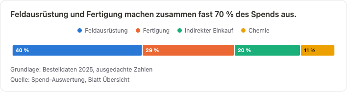
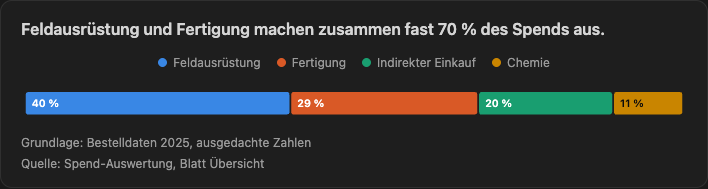
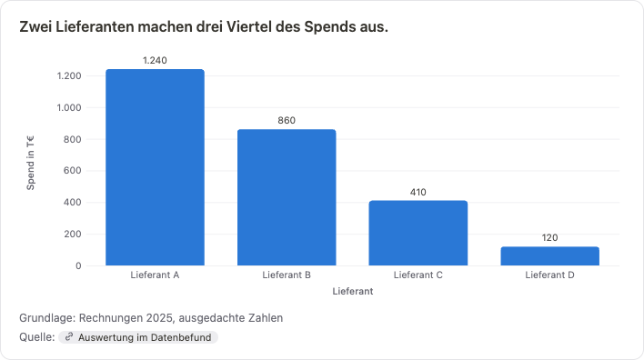
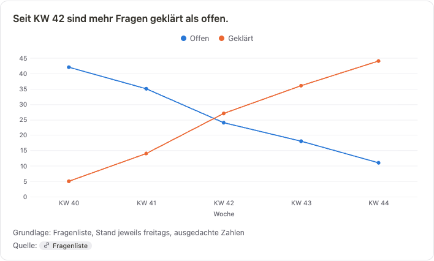
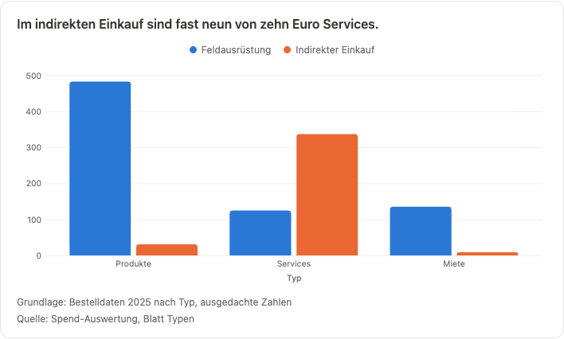
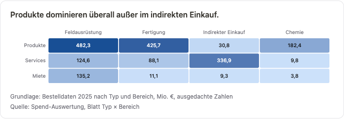
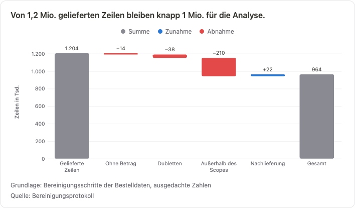
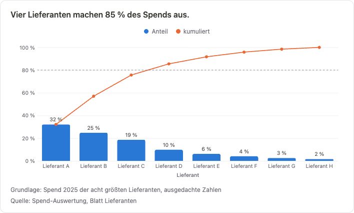
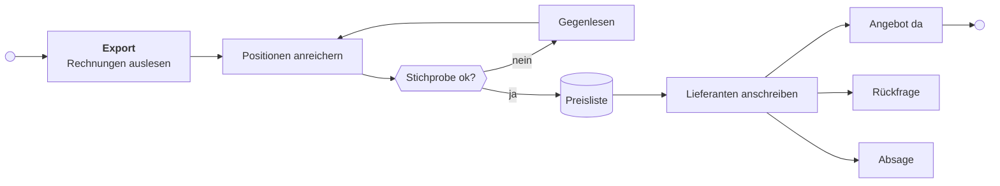
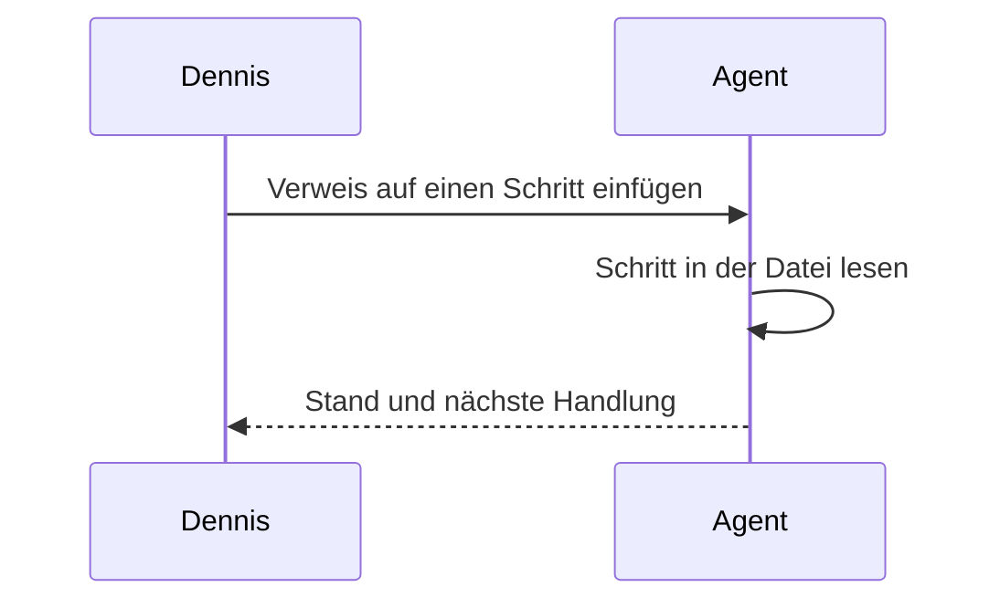

---
visual:
  status: In Arbeit
  created: 2026-10-28
  as-of: 2026-11-02
  lang: de
  share: intern
  badges: { angereichert: ok, offen: warn, fehlt: bad, läuft: info, später: muted }
---
# Alle Bausteine im Überblick

Diese Seite zeigt jeden Baustein, den Renderer und Theme heute können, an einem ausgedachten Projekt. Wer etwas an `src/` oder `style.less` ändert, öffnet sie im MPE-Preview und schaut, ob alles noch so aussieht wie beschrieben. Was noch nicht gebaut ist, steht im letzten Abschnitt.

## Stand-Band {#band updated=2026-11-01}

Das grüne Band über diesem Abschnitt kommt aus dem Frontmatter. Es zeigt Status, Stand und Erstellungsdatum. Rechts kopiert ein Knopf den Pfad dieser Datei. Ist `as-of` älter als sieben Tage, wird das Band gelb und sagt das dazu. Mit `share: intern` trägt das Band ein rotes Badge „Intern“, und im PDF steht oben rechts auf jeder Seite eine kleine Zeile „INTERN · nicht weitergeben“ mit dem Stand.

```yaml
visual:
  status: In Arbeit
  created: 2026-10-28
  as-of: 2026-11-02
  lang: de
  share: intern
  badges: { angereichert: ok, offen: warn, fehlt: bad, läuft: info, später: muted }
```

## Abschnitte mit Kennung {#abschnitte updated=2026-11-01}

Diese Überschrift ist selbst ein Beispiel. In der Datei steht `## Abschnitte mit Kennung {#abschnitte updated=2026-11-01}`. Im Preview verschwinden die Klammern, darunter stehen Kennung, Datum und ein Kopierknopf für `pfad.md#abschnitte`.

### Alter Abschnitt {#alt updated=2026-10-01}

Das Datum ist älter als sieben Tage und erscheint deshalb gelb.

### Abschnitt ohne Datum {#ohne-datum}

Hier fehlt `updated`, deshalb steht im Badge „Datum fehlt“.

### Abschnitt ohne Kennung

Überschriften ohne geschweifte Klammern bleiben unverändert.

## Schritte {#schritte updated=2026-11-01}

Der Block enthält jeden Zustand und jedes Feld. Die Beschreibungen sagen, worauf man jeweils achten soll.

```steps
- [x] daten: Rechnungen auslesen | owner: Team | updated: 2026-10-27
  Die Rechnungen aus dem Export sind ausgelesen und den richtigen Lieferanten zugeordnet. Fertige Schritte zeigen ihre Beschreibung grau und kein Ziel mehr.
- [~] anreichern: Positionen anreichern | status: [Ticket](https://example.com/issues/123) ist angelegt. Rechnungen sind zugeordnet, Stichprobe und Übernahme stehen aus. | owner: Agent | thread: [Thread: Positionen anreichern; ref=thread_beispiel] | next: Stichprobe ziehen und offene Felder klären | done-when: jede Position hat Maß, Material und Einheit | after: daten | updated: 2026-11-01
  Ein Agent ergänzt fehlende Angaben wie Maße, Material und Einheit. Unten stehen Agent-Icon und Thread. Der Kopierknopf rechts kopiert Pfad, Kennung und Thread.
- [ ] doku: Vorgehen dokumentieren | owner: Dennis | next: Gliederung anlegen | updated: 2026-10-31
  Hält fest, wie die Daten entstanden sind. Der Schritt hat keine offenen Abhängigkeiten und steht deshalb unter „Kann starten“.
- [ ] pruefen: Stichprobe gegenlesen | owner: Qualitätsteam | after: anreichern | done-when: 50 Positionen ohne systematischen Fehler | updated: 2026-11-01
  Das Qualitätsteam vergleicht eine Stichprobe mit den Originalrechnungen. Die Nummer unter „Dependencies“ ist indigo, weil der Schritt davor läuft.
- [ ] liste: Preisliste übernehmen | owner: Agent, danach Dennis | after: pruefen, freigabe | updated: 2026-11-01
  Die geprüften Daten gehen in die zentrale Preisliste. Eine Nummer ist grau, weil der Schritt noch nicht begonnen hat, die andere gelb, weil er wartet.
- [!] freigabe: Lieferantenauswahl freigeben | owner: Projektleitung | waiting-for: Rückmeldung zur geteilten Auswahl | since: 30. Oktober | updated: 2026-10-30
  Die Projektleitung entscheidet, mit welchen Lieferanten die erste Runde startet. „seit“ steht hinter dem Wartegrund.
- [ ] export: Altdaten exportieren | owner: Kunde | waiting-for: Zugang zum Altsystem | updated: 2026-10-20
  Ein offener Schritt mit Wartegrund landet unter „Wartet“. Das Datum ist älter als sieben Tage und erscheint gelb.
- [ ] archiv: Altdaten archivieren | owner: Team | after: export
  Ohne `updated` zeigt das letzte Badge „Datum fehlt“.
```

### Fehlerkasten {#fehler updated=2026-11-01}

Ein kaputter Block zeigt statt der Liste einen Fehlerkasten mit der Zeile in der Datei. Hier verweist `after` auf ein Kürzel, das es nicht gibt.

```steps
- [ ] a: Schritt mit falscher Abhängigkeit | after: gibtsnicht | updated: 2026-11-01
```

## Callouts {#callouts updated=2026-11-01}

Die fünf Arten von GitHub zeichnet MPE selbst.

> [!NOTE]
> Ein Hinweis, den man beim Überfliegen mitnehmen soll.

> [!TIP]
> Ein Tipp, der die Arbeit leichter macht.

> [!IMPORTANT]
> Etwas, das man für die Entscheidung wissen muss.

> [!WARNING]
> Etwas, das schiefgehen kann, wenn man es übersieht.

> [!CAUTION]
> Etwas, das man nicht tun sollte.

## Karten {#karten updated=2026-11-01}

Eine Karte ist ein Callout mit `[!card Icon Farbe]` und Titel in der ersten Zeile, darunter normales Markdown. Icons: `flag`, `question`, `check`, `warning`, `bulb`, `info`, `pin`, `clock`, `note`. Farben: `green`, `yellow`, `red`, `indigo`, `grey`.

> [!card flag green] E51: Pro Werk anfragen
> Entschieden am 30. Oktober. Wir fragen pro Werk an, weil die Preise je Standort verschieden sind.
>
> - ersetzt E47
> - gilt für Batch 1

> [!card question yellow] Frage 6: Bestellanhänge für alle Positionen?
> Gestellt an das Kundenteam am 28. Oktober, noch keine Antwort. Ohne die Anhänge fehlen Belege für etwa ein Drittel der Positionen.

> [!card warning red] Risiko: Zugang zum Altsystem
> Läuft der Zugang Ende November aus, fehlen die Altdaten für den Export.

> [!card bulb indigo] Idee: Stichprobe automatisch ziehen

> [!card note] Notiz ohne Farbe
> Ohne Farbe ist die Karte grau.

## Normales Markdown {#markdown updated=2026-11-01}

Text mit **fett**, *kursiv*, `Code` und einem [Link](https://github.com), der als Badge mit Link-Icon erscheint. Tastenkürzel wie <kbd>Cmd</kbd> + <kbd>C</kbd> haben eine eigene Form. Tabellen sehen aus wie die Karte der Schrittliste. Wörter, die unter `badges:` im Frontmatter stehen, erscheinen in Tabellenzellen als farbige Pillen.

| Lieferant | Positionen | Stand |
| --- | ---: | --- |
| Lieferant A | 120 | angereichert |
| Lieferant B | 45 | offen |
| Lieferant C | 80 | läuft |
| Lieferant D | 12 | fehlt |
| Lieferant E | 30 | später |

- [x] Eine erledigte Aufgabe
- [ ] Eine offene Aufgabe

> Ein normales Zitat ohne Callout-Art.

```js
const fortschritt = fertig / gesamt;
```

Formeln laufen über KaTeX: $\text{Fortschritt} = \frac{\text{fertig}}{\text{gesamt}}$

---

## Diagramme {#diagramme updated=2026-11-02}

Ein `chart`-Block steht direkt unter der Tabelle mit den Zahlen und sagt nur, welche Spalten wohin gehören. `says` ist die Aussage in einem Satz und steht über dem Diagramm, `basis` steht klein darunter und `source` mit dem Link zur Auswertung darunter. Zeilen wie „Gesamt“ oder „Summe“ lässt jedes Diagramm weg, nur der Wasserfall nutzt sie. Eine einzelne Reihe zeigt ihre Werte an den Balken, lange Namen legen die Balken quer.

| Lieferant | Spend in T€ |
| --- | ---: |
| Lieferant A | 1.240 |
| Lieferant B | 860 |
| Lieferant C | 410 |
| Lieferant D | 120 |

```chart
type: bar
x: Lieferant
y: Spend in T€
says: Zwei Lieferanten machen drei Viertel des Spends aus.
basis: Rechnungen 2025, ausgedachte Zahlen
source: [Auswertung im Datenbefund](bausteine.md#diagramme)
```

Mit `color` stapeln sich die Balken, `percent: yes` rechnet jede Säule auf 100 %.

| Werk | System | Positionen |
| --- | --- | ---: |
| Nord | SAP | 320 |
| Nord | Altsystem | 80 |
| Süd | SAP | 150 |
| Süd | Altsystem | 210 |
| West | SAP | 90 |
| West | Altsystem | 40 |

```chart
type: bar
x: Werk
y: Positionen
color: System
percent: yes
says: Im Werk Süd kommt mehr als die Hälfte der Positionen aus dem Altsystem.
basis: Bestellpositionen 2025, ausgedachte Zahlen
source: Datenbefund, Abschnitt Herkunft
```

Mehrere Spalten in `y` werden zu Linien. Die Reihenfolge der Wochen kommt aus der Tabelle.

| Woche | Offen | Geklärt |
| --- | ---: | ---: |
| KW 40 | 42 | 5 |
| KW 41 | 35 | 14 |
| KW 42 | 24 | 27 |
| KW 43 | 18 | 36 |
| KW 44 | 11 | 44 |

```chart
type: line
x: Woche
y: Offen, Geklärt
says: Seit KW 42 sind mehr Fragen geklärt als offen.
basis: Fragenliste, Stand jeweils freitags, ausgedachte Zahlen
source: [Fragenliste](bausteine.md#karten)
```

Ein Histogramm braucht die schon ausgezählte Verteilung, die Klassen stehen in der ersten Spalte.

| Textlänge | Positionen |
| --- | ---: |
| 0–10 | 12 |
| 11–20 | 48 |
| 21–30 | 95 |
| 31–39 | 70 |
| 40 | 160 |

```chart
type: histogram
x: Textlänge
y: Positionen
says: Viele Texte enden bei genau 40 Zeichen, dort schneidet das Altsystem ab.
basis: Positionstexte 2025, ausgedachte Zahlen
source: Datenbefund, Abschnitt Positionstexte
```

### Kennzahlen {#kennzahlen updated=2026-11-02}

`kpi` zeigt Kennzahlen als Kacheln. Der Wert steht so in der Kachel, wie er in der Tabelle steht, also auch mit Einheit.

| Kennzahl | Wert | Hinweis |
| --- | --- | --- |
| Spend 2025 | 1,84 Mrd. € | alle gelieferten Zeilen |
| Datensätze | 1.204.330 | davon 14.210 ohne Betrag |
| Bestellnummern | 402.118 | nicht jede Zeile hat eine |
| Lieferanten | 6.912 | nach Bereinigung |

```chart
type: kpi
x: Kennzahl
y: Wert
note: Hinweis
says: Der Datenstand auf einen Blick.
basis: Bestelldaten 2025, ausgedachte Zahlen
source: Spend-Auswertung, Blatt Übersicht
```

### Anteile {#anteile updated=2026-11-02}

`share` teilt ein Ganzes in höchstens sechs Teile, der Rest landet unter „Sonstige“. Die Zeile „Gesamt“ bleibt in der Tabelle und fehlt im Balken.

| Bereich | Spend in Mio. € |
| --- | ---: |
| Feldausrüstung | 742,1 |
| Fertigung | 524,9 |
| Indirekter Einkauf | 377,0 |
| Chemie | 196,0 |
| **Gesamt** | **1.840,0** |

```chart
type: share
x: Bereich
y: Spend in Mio. €
says: Feldausrüstung und Fertigung machen zusammen fast 70 % des Spends aus.
basis: Bestelldaten 2025, ausgedachte Zahlen
source: Spend-Auswertung, Blatt Übersicht
```

### Gruppierte Balken {#gruppiert updated=2026-11-02}

Mehrere Spalten in `y` mit `grouped: yes` stehen nebeneinander statt gestapelt. Das passt, wenn man die Reihen untereinander vergleichen will.

| Typ | Feldausrüstung | Indirekter Einkauf |
| --- | ---: | ---: |
| Produkte | 482,3 | 30,8 |
| Services | 124,6 | 336,9 |
| Miete | 135,2 | 9,3 |

```chart
type: bar
x: Typ
y: Feldausrüstung, Indirekter Einkauf
grouped: yes
says: Im indirekten Einkauf sind fast neun von zehn Euro Services.
basis: Bestelldaten 2025 nach Typ, ausgedachte Zahlen
source: Spend-Auswertung, Blatt Typen
```

### Heatmap {#heatmap updated=2026-11-02}

`heatmap` zeigt eine Matrix: Zeilen aus `x`, Spalten aus den Spalten in `y`. Jede Zelle trägt ihren Wert, je dunkler, desto mehr.

| Typ | Feldausrüstung | Fertigung | Indirekter Einkauf | Chemie |
| --- | ---: | ---: | ---: | ---: |
| Produkte | 482,3 | 425,7 | 30,8 | 182,4 |
| Services | 124,6 | 88,1 | 336,9 | 9,8 |
| Miete | 135,2 | 11,1 | 9,3 | 3,8 |

```chart
type: heatmap
x: Typ
y: Feldausrüstung, Fertigung, Indirekter Einkauf, Chemie
says: Produkte dominieren überall außer im indirekten Einkauf.
basis: Bestelldaten 2025 nach Typ und Bereich, Mio. €, ausgedachte Zahlen
source: Spend-Auswertung, Blatt Typ × Bereich
```

### Wasserfall {#wasserfall updated=2026-11-02}

`waterfall` beginnt mit dem Wert der ersten Zeile und addiert die folgenden. Eine Zeile „Gesamt“ zeigt den laufenden Stand, ihr Wert in der Tabelle darf leer sein.

| Schritt | Zeilen in Tsd. |
| --- | ---: |
| Gelieferte Zeilen | 1.204 |
| Ohne Betrag | -14 |
| Dubletten | -38 |
| Außerhalb des Scopes | -210 |
| Nachlieferung | 22 |
| Gesamt | |

```chart
type: waterfall
x: Schritt
y: Zeilen in Tsd.
says: Von 1,2 Mio. gelieferten Zeilen bleiben knapp 1 Mio. für die Analyse.
basis: Bereinigungsschritte der Bestelldaten, ausgedachte Zahlen
source: Bereinigungsprotokoll
```

### Pareto {#pareto updated=2026-11-02}

`pareto` sortiert die Teile absteigend und zeigt den kumulierten Anteil. Die gestrichelte Linie liegt bei 80 %.

| Lieferant | Spend in Mio. € |
| --- | ---: |
| Lieferant A | 310 |
| Lieferant B | 240 |
| Lieferant C | 180 |
| Lieferant D | 95 |
| Lieferant E | 60 |
| Lieferant F | 40 |
| Lieferant G | 25 |
| Lieferant H | 15 |

```chart
type: pareto
x: Lieferant
y: Spend in Mio. €
says: Vier Lieferanten machen 85 % des Spends aus.
basis: Spend 2025 der acht größten Lieferanten, ausgedachte Zahlen
source: Spend-Auswertung, Blatt Lieferanten
```

### Streudiagramm {#streudiagramm updated=2026-11-02}

`scatter` setzt zwei Zahlenspalten gegeneinander. `label` schreibt einen Namen an jeden Punkt, bei höchstens 20 Punkten.

| Lieferant | Bestellungen | Preisabweichung in % |
| --- | ---: | ---: |
| Lieferant A | 1.240 | 2,1 |
| Lieferant B | 860 | 4,8 |
| Lieferant C | 410 | 11,5 |
| Lieferant D | 120 | 18,2 |
| Lieferant E | 640 | 6,3 |

```chart
type: scatter
x: Bestellungen
y: Preisabweichung in %
label: Lieferant
says: Wer selten bestellt wird, weicht im Preis stärker ab.
basis: Bestellungen und Preise 2025, ausgedachte Zahlen
source: Spend-Auswertung, Blatt Preise
```

### Fortschritt {#fortschritt updated=2026-11-02}

`progress` misst jede Zeile an ihrem Ziel aus der Spalte in `target`.

| Arbeitspaket | Erledigt | Ziel |
| --- | ---: | ---: |
| Positionen angereichert | 6.200 | 8.000 |
| Stichprobe geprüft | 35 | 50 |
| Lieferanten angefragt | 12 | 40 |

```chart
type: progress
x: Arbeitspaket
y: Erledigt
target: Ziel
says: Die Anreicherung ist fast durch, die Anfragen haben gerade erst begonnen.
basis: Arbeitsstand, ausgedachte Zahlen
source: [Arbeitsliste](bausteine.md#schritte)
```

## Skalen {#skalen updated=2026-11-02}

`scale` zeigt Schwellen und Bereiche als ein Band. Jede Zeile ist ein Bereich mit Grenzen, Name und einer Farbe aus `ok`, `warn`, `bad`, `info` und `muted`. `marker` setzt Werte darauf, auch mehrmals.

```scale
says: Ab 70 Punkten gilt ein Kunde als gesund, Kunde B rutscht gerade ab.
unit: Punkte
- 0–40: Kritisch | bad
- 40–70: Gefährdet | warn
- 70–100: Gesund | ok
marker: 82 | Kunde A
marker: 64 | Kunde B
basis: Health Score, ausgedachte Werte
source: [Bewertungsregeln](bausteine.md#skalen)
```

Ohne Markierungen und mit ungleich breiten Bereichen:

```scale
says: Nur Abweichungen über 5 % gehen an den Einkauf.
unit: %
- 0–2: im Rahmen | ok
- 2–5: beobachten | info
- 5–20: an den Einkauf | warn
```

## Galerie {#galerie updated=2026-11-02}

`gallery` stellt Bilder nebeneinander. Jede Zeile ist ein normales Markdown-Bild, der Text dahinter wird zur Bildunterschrift. Ohne `columns` stehen bis zu drei Bilder in einer Reihe.

```gallery
says: Der Anteilsbalken hell und dunkel.
 Helles Theme
 Dunkles Theme
```

Mehr Bilder als Spalten laufen in weitere Reihen, so wird die Galerie zum Raster. Hier sechs Bilder in drei Spalten, `columns` geht bis 6:

```gallery
says: Sechs Diagrammtypen auf einen Blick.
columns: 3
 Balken mit Werten
 Linie über Wochen
 Gruppierte Balken
 Heatmap
 Wasserfall
 Pareto
```

## Vergleich {#vergleich updated=2026-11-02}

`compare` stellt zwei bis vier Ansätze nebeneinander. Eine Option beginnt mit `- Titel`, darunter stehen eingerückt Text, `+ Vorteil` und `- Nachteil`. `| empfohlen` markiert die Empfehlung mit einem Badge.

```compare
says: Der Parser-Hook reicht, eine eigene Extension lohnt sich erst mit eigenem Viewer.
- Parser-Hook in MPE | empfohlen
  Unser Kern läuft vor dem Markdown-Rendering.
  + läuft auch im PDF-Export
  + Kollegen brauchen nur das Repo
  - kein `Intl`, Zahlen werden von Hand formatiert
- Eigene VS-Code-Extension
  + volle Kontrolle über das Preview
  - jeder muss sie installieren
  - PDF-Export müssten wir selbst bauen
- Eigener Viewer
  + unabhängig von VS Code
  - am meisten Arbeit
```

## Mermaid {#mermaid updated=2026-11-01}



Code, Modellschritt, Mensch, Entscheidung und Ablage haben je eine eigene Farbe. Blau ist der hervorgehobene Schritt, Grün, Gelb und Rot sind Ergebnisse, die Punkte Start und Ende.



## Verweise und Begriffe {#verweise updated=2026-11-02}

Eine Karte, deren Titel mit einer ID beginnt, definiert sie, etwa E51 oder Frage 6 oben bei den Karten. Überall sonst im Text wird die ID zum Link auf die Karte, und beim Hovern steht ihr Titel. E47 bleibt Text, weil keine Karte sie definiert.

Begriffe stehen in einem `glossary`-Block, der als Tabelle erscheint. Im Text wird ein Begriff beim ersten Auftreten pro Abschnitt zum Link auf seine Zeile, beim Hovern steht die Erklärung. Jede PO kann mehrere Positionen haben, die zweite PO in diesem Abschnitt bleibt deshalb ohne Linie. In `Code`, in Links und in Überschriften wird nichts verlinkt.

```glossary
PO: Bestellung im SAP, eine Nummer kann mehrere Positionen haben
MPE: Markdown Preview Enhanced, die VS-Code-Erweiterung für diese Vorschau
Spend: Ausgaben für eingekaufte Waren und Leistungen in einem Zeitraum
```

Die Definitionen müssen in derselben Datei stehen, weil der Parser keine anderen Dateien lesen kann. Ein Verweis in eine andere Datei bleibt ein normaler Link.
