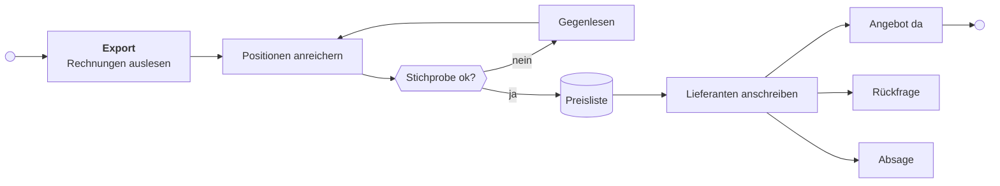
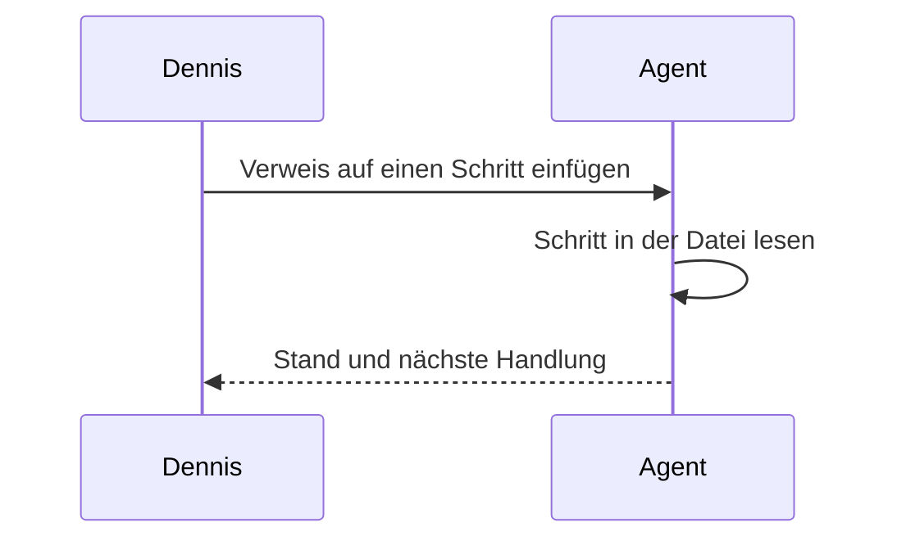

---
visual:
  status: In Arbeit
  created: 2026-10-28
  as-of: 2026-11-01
  lang: de
  share: intern
  badges: { angereichert: ok, offen: warn, fehlt: bad, läuft: info, später: muted }
---
# Alle Bausteine im Überblick

Diese Seite zeigt jeden Baustein, den Renderer und Theme heute können, an einem ausgedachten Projekt. Wer etwas an `src/` oder `style.less` ändert, öffnet sie im MPE-Preview und schaut, ob alles noch so aussieht wie beschrieben. Was noch nicht gebaut ist, steht im letzten Abschnitt.

## Stand-Band {#band updated=2026-11-01}

Das grüne Band über diesem Abschnitt kommt aus dem Frontmatter. Es zeigt Status, Stand und Erstellungsdatum. Rechts kopiert ein Knopf den Pfad dieser Datei. Ist `as-of` älter als sieben Tage, wird das Band gelb und sagt das dazu. Mit `share: intern` trägt das Band ein rotes Badge „Intern“, und im PDF steht auf jeder Seite schräg „Intern“ mit dem Hinweis „nicht weitergeben“ und dem Stand.

```yaml
visual:
  status: In Arbeit
  created: 2026-10-28
  as-of: 2026-11-01
  lang: de
  share: intern
  badges: { angereichert: ok, offen: warn, fehlt: bad, läuft: info, später: muted }
```

## Abschnitte mit Kennung {#abschnitte updated=2026-11-01}

Diese Überschrift ist selbst ein Beispiel. In der Datei steht `## Abschnitte mit Kennung {#abschnitte updated=2026-11-01}`. Im Preview verschwinden die Klammern, darunter stehen Kennung, Datum und ein Kopierknopf für `pfad.md#abschnitte`.

### Alter Abschnitt {#alt updated=2026-10-01}

Das Datum ist älter als sieben Tage und erscheint deshalb gelb.

### Abschnitt ohne Datum {#ohne-datum}

Hier fehlt `updated`, deshalb steht im Badge „Datum fehlt“.

### Abschnitt ohne Kennung

Überschriften ohne geschweifte Klammern bleiben unverändert.

## Schritte {#schritte updated=2026-11-01}

Der Block enthält jeden Zustand und jedes Feld. Die Beschreibungen sagen, worauf man jeweils achten soll.

```steps
- [x] daten: Rechnungen auslesen | owner: Team | updated: 2026-10-27
  Die Rechnungen aus dem Export sind ausgelesen und den richtigen Lieferanten zugeordnet. Fertige Schritte zeigen ihre Beschreibung grau und kein Ziel mehr.
- [~] anreichern: Positionen anreichern | owner: Agent | thread: [Thread: Positionen anreichern; ref=thread_beispiel] | next: Stichprobe ziehen und offene Felder klären | done-when: jede Position hat Maß, Material und Einheit | after: daten | updated: 2026-11-01
  Ein Agent ergänzt fehlende Angaben wie Maße, Material und Einheit. Unten stehen Agent-Icon und Thread. Der Kopierknopf rechts kopiert Pfad, Kennung und Thread.
- [ ] doku: Vorgehen dokumentieren | owner: Dennis | next: Gliederung anlegen | updated: 2026-10-31
  Hält fest, wie die Daten entstanden sind. Der Schritt hat keine offenen Abhängigkeiten und steht deshalb unter „Kann starten“.
- [ ] pruefen: Stichprobe gegenlesen | owner: Qualitätsteam | after: anreichern | done-when: 50 Positionen ohne systematischen Fehler | updated: 2026-11-01
  Das Qualitätsteam vergleicht eine Stichprobe mit den Originalrechnungen. Die Nummer unter „Dependencies“ ist indigo, weil der Schritt davor läuft.
- [ ] liste: Preisliste übernehmen | owner: Agent, danach Dennis | after: pruefen, freigabe | updated: 2026-11-01
  Die geprüften Daten gehen in die zentrale Preisliste. Eine Nummer ist grau, weil der Schritt noch nicht begonnen hat, die andere gelb, weil er wartet.
- [!] freigabe: Lieferantenauswahl freigeben | owner: Projektleitung | waiting-for: Rückmeldung zur geteilten Auswahl | since: 30. Oktober | updated: 2026-10-30
  Die Projektleitung entscheidet, mit welchen Lieferanten die erste Runde startet. „seit“ steht hinter dem Wartegrund.
- [ ] export: Altdaten exportieren | owner: Kunde | waiting-for: Zugang zum Altsystem | updated: 2026-10-20
  Ein offener Schritt mit Wartegrund landet unter „Wartet“. Das Datum ist älter als sieben Tage und erscheint gelb.
- [ ] archiv: Altdaten archivieren | owner: Team | after: export
  Ohne `updated` zeigt das letzte Badge „Datum fehlt“.
```

### Fehlerkasten {#fehler updated=2026-11-01}

Ein kaputter Block zeigt statt der Liste einen Fehlerkasten mit der Zeile in der Datei. Hier verweist `after` auf ein Kürzel, das es nicht gibt.

```steps
- [ ] a: Schritt mit falscher Abhängigkeit | after: gibtsnicht | updated: 2026-11-01
```

## Callouts {#callouts updated=2026-11-01}

Die fünf Arten von GitHub zeichnet MPE selbst.

> [!NOTE]
> Ein Hinweis, den man beim Überfliegen mitnehmen soll.

> [!TIP]
> Ein Tipp, der die Arbeit leichter macht.

> [!IMPORTANT]
> Etwas, das man für die Entscheidung wissen muss.

> [!WARNING]
> Etwas, das schiefgehen kann, wenn man es übersieht.

> [!CAUTION]
> Etwas, das man nicht tun sollte.

## Karten {#karten updated=2026-11-01}

Eine Karte ist ein Callout mit `[!card Icon Farbe]` und Titel in der ersten Zeile, darunter normales Markdown. Icons: `flag`, `question`, `check`, `warning`, `bulb`, `info`, `pin`, `clock`, `note`. Farben: `green`, `yellow`, `red`, `indigo`, `grey`.

> [!card flag green] E51: Pro Werk anfragen
> Entschieden am 30. Oktober. Wir fragen pro Werk an, weil die Preise je Standort verschieden sind.
>
> - ersetzt E47
> - gilt für Batch 1

> [!card question yellow] Frage 6: Bestellanhänge für alle Positionen?
> Gestellt an das Kundenteam am 28. Oktober, noch keine Antwort. Ohne die Anhänge fehlen Belege für etwa ein Drittel der Positionen.

> [!card warning red] Risiko: Zugang zum Altsystem
> Läuft der Zugang Ende November aus, fehlen die Altdaten für den Export.

> [!card bulb indigo] Idee: Stichprobe automatisch ziehen

> [!card note] Notiz ohne Farbe
> Ohne Farbe ist die Karte grau.

## Normales Markdown {#markdown updated=2026-11-01}

Text mit **fett**, *kursiv*, `Code` und einem [Link](https://github.com), der als Badge mit Link-Icon erscheint. Tastenkürzel wie <kbd>Cmd</kbd> + <kbd>C</kbd> haben eine eigene Form. Tabellen sehen aus wie die Karte der Schrittliste. Wörter, die unter `badges:` im Frontmatter stehen, erscheinen in Tabellenzellen als farbige Pillen.

| Lieferant | Positionen | Stand |
| --- | ---: | --- |
| Lieferant A | 120 | angereichert |
| Lieferant B | 45 | offen |
| Lieferant C | 80 | läuft |
| Lieferant D | 12 | fehlt |
| Lieferant E | 30 | später |

- [x] Eine erledigte Aufgabe
- [ ] Eine offene Aufgabe

> Ein normales Zitat ohne Callout-Art.

```js
const fortschritt = fertig / gesamt;
```

Formeln laufen über KaTeX: $\text{Fortschritt} = \frac{\text{fertig}}{\text{gesamt}}$

---

## Diagramme {#diagramme updated=2026-11-02}

Ein `chart`-Block steht direkt unter der Tabelle mit den Zahlen und sagt nur, welche Spalten wohin gehören. `says` ist die Aussage in einem Satz und steht über dem Diagramm, `basis` steht klein darunter. Eine einzelne Reihe zeigt ihre Werte an den Balken, lange Namen legen die Balken quer.

| Lieferant | Spend in T€ |
| --- | ---: |
| Lieferant A | 1.240 |
| Lieferant B | 860 |
| Lieferant C | 410 |
| Lieferant D | 120 |

```chart
type: bar
x: Lieferant
y: Spend in T€
says: Zwei Lieferanten machen drei Viertel des Spends aus.
basis: Rechnungen 2025, ausgedachte Zahlen
```

Mit `color` stapeln sich die Balken, `percent: yes` rechnet jede Säule auf 100 %.

| Werk | Quelle | Positionen |
| --- | --- | ---: |
| Nord | SAP | 320 |
| Nord | Cameron | 80 |
| Süd | SAP | 150 |
| Süd | Cameron | 210 |
| West | SAP | 90 |
| West | Cameron | 40 |

```chart
type: bar
x: Werk
y: Positionen
color: Quelle
percent: yes
says: Im Werk Süd kommt mehr als die Hälfte der Positionen aus Cameron.
basis: Bestellpositionen 2025, ausgedachte Zahlen
```

Mehrere Spalten in `y` werden zu Linien. Die Reihenfolge der Wochen kommt aus der Tabelle.

| Woche | Offen | Geklärt |
| --- | ---: | ---: |
| KW 40 | 42 | 5 |
| KW 41 | 35 | 14 |
| KW 42 | 24 | 27 |
| KW 43 | 18 | 36 |
| KW 44 | 11 | 44 |

```chart
type: line
x: Woche
y: Offen, Geklärt
says: Seit KW 42 sind mehr Fragen geklärt als offen.
basis: Fragenliste, Stand jeweils freitags, ausgedachte Zahlen
```

Ein Histogramm braucht die schon ausgezählte Verteilung, die Klassen stehen in der ersten Spalte.

| Textlänge | Positionen |
| --- | ---: |
| 0–10 | 12 |
| 11–20 | 48 |
| 21–30 | 95 |
| 31–39 | 70 |
| 40 | 160 |

```chart
type: histogram
x: Textlänge
y: Positionen
says: Viele Texte enden bei genau 40 Zeichen, dort schneidet das Altsystem ab.
basis: Positionstexte 2025, ausgedachte Zahlen
```

## Mermaid {#mermaid updated=2026-11-01}



Code, Modellschritt, Mensch, Entscheidung und Ablage haben je eine eigene Farbe. Blau ist der hervorgehobene Schritt, Grün, Gelb und Rot sind Ergebnisse, die Punkte Start und Ende.



## Noch nicht gebaut {#offen updated=2026-11-01}

Die erste Runde ist vollständig. Die zweite Runde mit Links und Erklärungen für IDs, `scale`, `gallery` und `compare` ist noch nicht begonnen.
